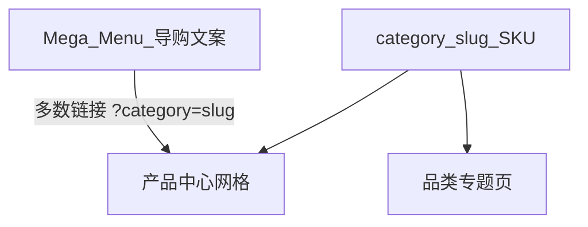

# 产品分类与导航：怎么分才合理

## 当前站点里其实有两套「名字」

| 层级 | 是什么 | 例子 | 数据从哪来 |
|------|--------|------|------------|
| **A. 职能导航（Mega Menu）** | 外贸买家习惯的 **7 大栏 + 细项文案** | Punch Components → Stepped Punches | [`src/data/nav-product-mega-menu.ts`](../src/data/nav-product-mega-menu.ts) + `nav.productMega` 翻译 |
| **B. 目录 SKU 品类（category slug）** | 每条产品 MD 上的 **`category:`**，决定 URL 与筛选 | `stepped-punches`, `punch-pins` | [`src/content/products/*.md`](../src/content/products/) + [`src/i18n/messages/*.json`](../src/i18n/messages/) 的 `products.categories` |

**结论：不是两套互相矛盾的业务，而是「导购文案」和「库存/URL 品类」两层。**

- Mega 里多项可以 **指向同一个 category**（例如红/蓝/绿模具弹簧都链到 `die-springs`）。
- Mega 里一项也可以 **指向具体 SKU**（`category` + `productSlug`）。
- 产品中心下拉 **「产品类型」** 目前用的是 **B：实际有 SKU 的 category slug**，标签是 `products.categories`（偏站内/CMS 命名），**不是** Mega 里每一行小字。

所以你会觉得「下拉很多种类」和「产品类型下拉」对不上——**部分不合理，部分是故意的**：

- **合理**：SKU 只能按 slug 筛选；弹簧颜色在数据里还没拆成不同 SKU 时，筛选项只能是 `die-springs`。
- **不合理（体验）**：买家在 Mega 点了「Stepped Punches」，进产品中心却看到选项叫「Stepped Punches」还好，但若中文站显示「台阶冲针」与 Mega「冲压模冲头」混用 `punch-pins` / `stamping-die-punches` 不直观，需要 **统一文案来源**。

## 建议的「正确分法」（模具配件 B2B）

### 1. 对外导航（PC Mega + 移动）

- **按职能 7 列**（冲头 / 顶出 / 导向 / 弹簧 / 塑胶 / 铜件 / 定位销），与 HTX 英文站一致，**不按 htx99 中文行业树**做主入口。
- 移动端 **不能依赖 hover**（见下节），应有点击展开的 **全宽折叠面板** 或 **独立「产品分类」页**。

### 2. 产品中心列表

- **筛选维度**：只保留与 SKU 一致的 **`category` slug**（或以后加 `material` 当 MD 写规范后）。
- **文案**：下拉选项建议改为 **按 Mega 分组的 optgroup**，组名 = 7 栏标题，选项 label 优先用 Mega 链接译名，**value 仍是 category slug**；同一 slug 多行 Mega 链接 **合并为一项**，避免重复。
- **底部专题链接**：保留 `/products/{category}/` 着陆页（工艺说明），与列表筛选分工不变。

### 3. 内容 / URL（长期）

- **一个 SKU 只有一个 `category`**（主品类）。
- 细粒度（材质、台阶、异型）用 **产品标题 + 将来可选 `tags`**，不要为每个 Mega 小字各建 slug，除非真有独立着陆页需求。

## 移动端 vs PC：产品中心弹窗

- **PC（lg+）**：[`Nav.astro`](../src/components/Nav.astro) 悬停「产品中心」→ `.products-mega-panel`（`lg:block`，JS 延迟关闭）。
- **移动（&lt; lg）**：同一面板是 **`hidden lg:block`**，顶栏只有 **直达 `/products/` 的链接**，**没有 Mega**——这是当前「不一致」的原因，不是 bug，是 **未做移动版分类 UI**。

**待实现（Agent 模式）**：

1. 移动顶栏「产品中心」改为 **按钮 + `aria-expanded`**，点击展开 **手风琴 / 全屏层**，内容与 PC 相同 7 列（小屏改为单列或两列滚动）。
2. 路由切换时关闭面板；与 PC 共用 [`productMegaMenuColumns`](../src/data/nav-product-mega-menu.ts) 数据，避免两套菜单。

## 和冲针出图工具的关系

- 出图 batch 用 **categorySlug + material**（见 [`docs/image-gen-terrakinc.md`](./image-gen-terrakinc.md)）。
- 生成图文件名与 slug 对齐，**人工**替换 MD 的 `heroImage` 后，产品中心网格与 Mega 跳转才会一致。
