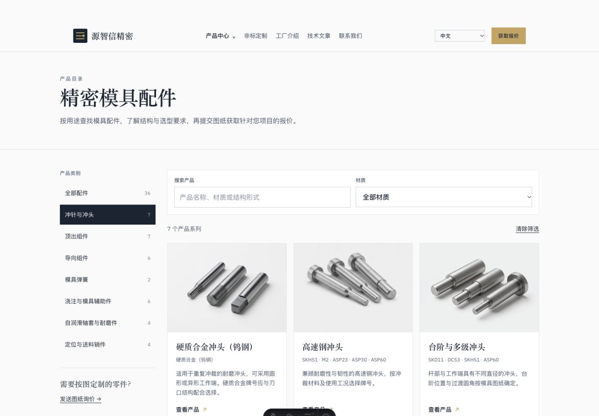
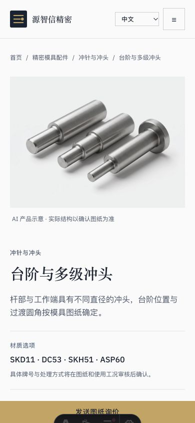

# 冲针与冲头图片替换

7 个系列图片已逐张生成、目视检查，并接入本地网站。此次生成 7 次，未自动重试。高速钢冲头裁掉主体之外多余残影并中和色调，保留原图。

三语产品列表、分类页、详情页与首页分类入口均共用新图。所有导出为 1600×1200 WebP，详情页注明 AI 产品示意。

验证：Astro 检查无错误，396 页构建通过；21 个三语详情页、6 个列表/分类页和 3 个首页入口已核对。1440 像素桌面与 390 像素手机视口无横向溢出，7 张图加载正常。

各图片原图、实际提示词与审核记录见 ../candidates 下对应产品及生成日期目录。只更新本地项目，未执行远程部署。
