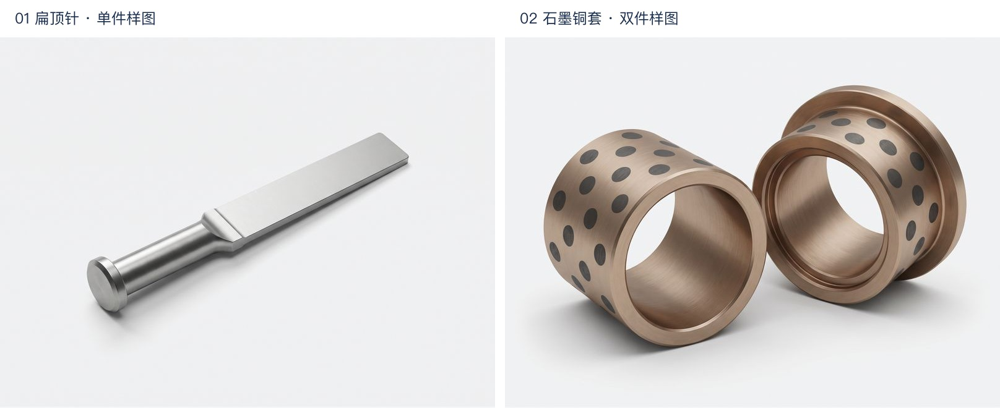

# 首轮样图评审

使用用户指定的 Terrakinc / gemini-3.0-pro-image。共提交 3 次生成请求，保存 2 张图片，没有自动重试，没有发布网站。

- 台阶冲头：第一笔响应未解析出图片；供应商日志存在消费记录。旧客户端未保存原始响应，无法从本地恢复。未重复提交。
- 扁顶针：背景、光线可作风格参考；扁位偏宽、杆部偏短，需要结构修订。
- 石墨铜套：双件构图及铜材质可供比较；内孔缺少可见石墨块，下一版应明确内孔轴承工作面。

两张仅为 AI 产品示意草稿，尚未达到正式商品图的结构审核标准。当前目录提示词已收紧结构条件，但没有再次付费生成。

## 实际使用的提示词

- [扁顶针提示词](../candidates/blade-ejector-pins/2026-09-29T15-15-40-306Z/prompt.txt)
- [石墨铜套提示词](../candidates/graphite-bronze-bushings/2026-09-29T15-17-13-742Z/prompt.txt)

每张原图、提示词与 generation.json 保存在对应 candidates 目录，后续修改不会覆盖本轮结果。
